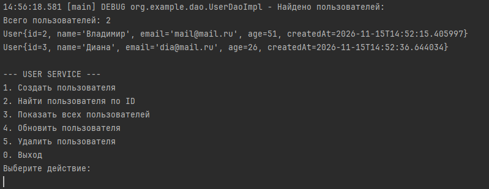
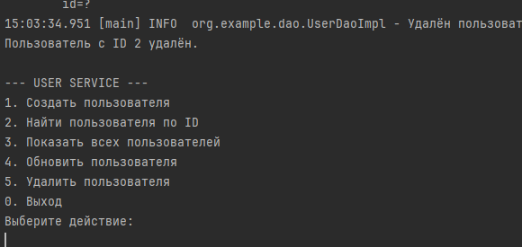
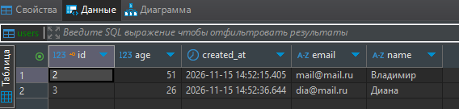
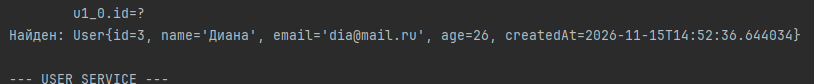

**Использование фреймворка Hibernate в комбинации с PostgreSQL для создания простейшего CRUD-приложения с консольным 
интерактивом.**

База данных PostgreSQL поднимается в контейнере Docker. DBeaver использовался для проверки 
сформированной таблицы и уточнения заполненных данных.

# 1. Меню; выбор операции; логирование

# 2. Просмотр сфромированного списка пользователей

# 3. Удаление пользователя (session.remove(user);)

# До удаления пользователя:

# После удаления пользователя:

Для проверки заполнения таблицы использовался тестовый пример пользователя, а также было произведено его удаление.
В задании сказано:
>*Обработать возможные исключения, связанные с Hibernate и PostgreSQL*
>
В принципе можно было добавить обработку автоинкремента. Но официально это является фичей, а не исключением, 
потому подумал оставить как есть.
# Проверка иммутабельности ID после удаления предыдущего по порядку элемента 

#
#
