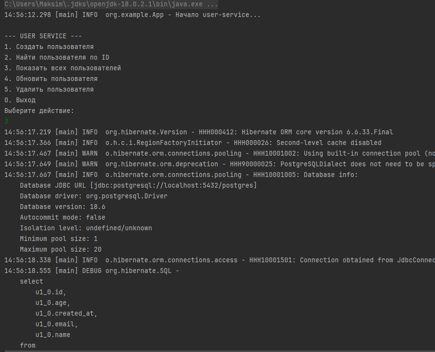
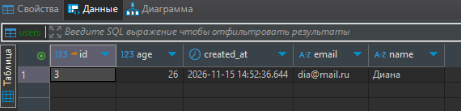

**Использование фреймворка Hibernate в комбинации с PostgreSQL для создания простейшего CRUD-приложения с консольным 
интерактивом.**

База данных PostgreSQL поднимается в контейнере Docker. DBeaver использовался для проверки 
сформированной таблицы, уточнения заполненных данных и аналитического анализа части ACID-принципов транзакции.

# 1. Меню; выбор операции; логирование

# 2. Просмотр сфромированного списка пользователей

# 3. Удаление пользователя (session.remove(user);)

# До удаления пользователя:

# После удаления пользователя:

# Проверка иммутабельности ID после удаления предыдущего элемента 
