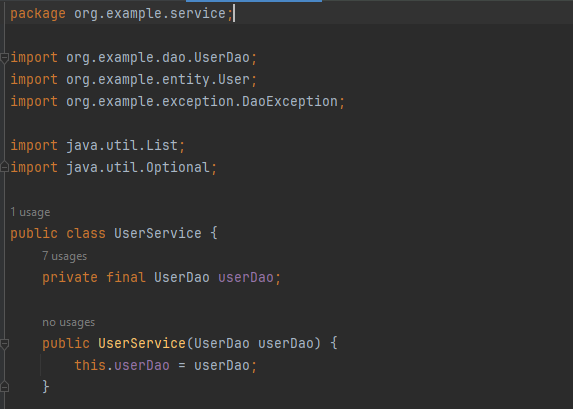
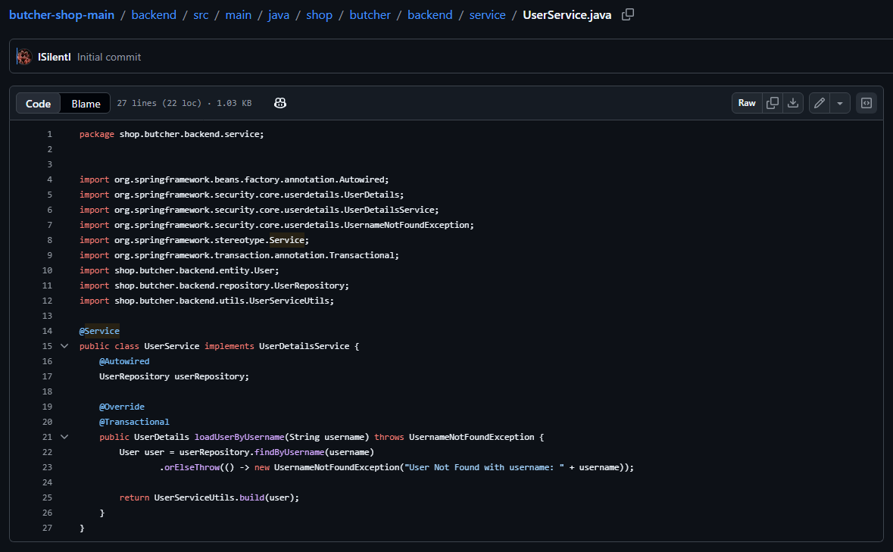
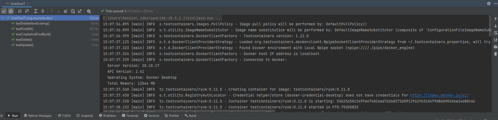
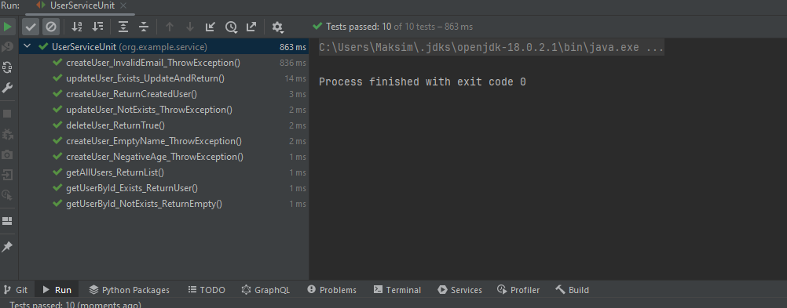
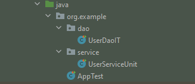
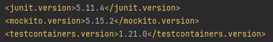

**Написать юнит-тесты и интеграционные тесты для user-service.**
- **Использовать JUnit 5, Mockito и Testcontainers.**
- **Для тестирования DAO-слоя написать интеграционные тесты с использованием Testcontainers.**
- **Для тестирования Service-слоя написать юнит-тесты с использованием Mockito.**
- **Тесты должны быть изолированы друг от друга.**

$\color{#f00}{\textsf{ПЕРЕХОД  К ТЕСТАМ: }}$ [click](src/test/java/org/example)

На предыдщей онлайн-сессии практического занятия хоть и было сказано о тестировании только основных операций, но
раз каждое ДЗ начинает быть частью последующего (а в будущем однозначно потребуется создание промежуточного сервиса),
потому я решил сразу интегрировать UserService.

# 1. Создание промежуточного UserService (между UserDao и App):

На примере блока кода ниже из моего клиент-серверного приложения я
написал UserService (аннотации принадлежат Spring-фреймврку, потому их не добавлял в проект-ДЗ, но можно было вписать
хотя бы @Override).
# 1.1. Пример блока кода UserService

# 2. Тестирование UserDaoIT - интеграционные тесты с Testcontainers (работа с БД, SQL):

# 3. Тестирвание UserServiceUnit - юнит-тесты с Mockito (бизнес-логика):

# 4. Изоляция тестов:

# 5. Добавленные зависимости фрейморвка и библиотек:

#
